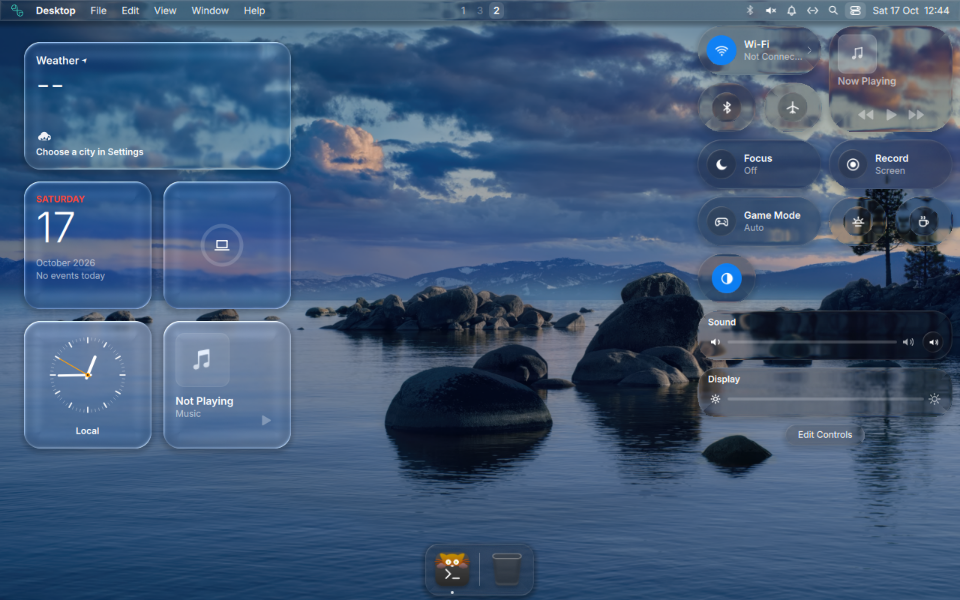
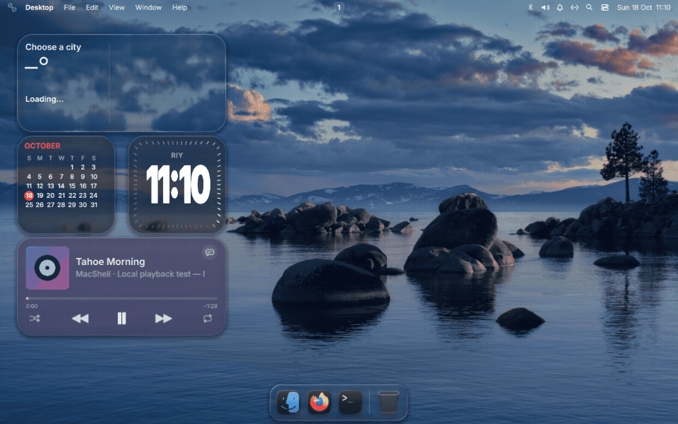
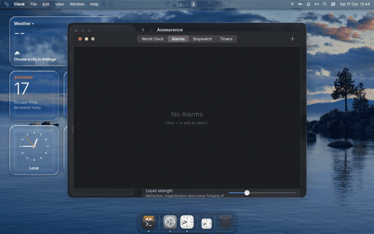
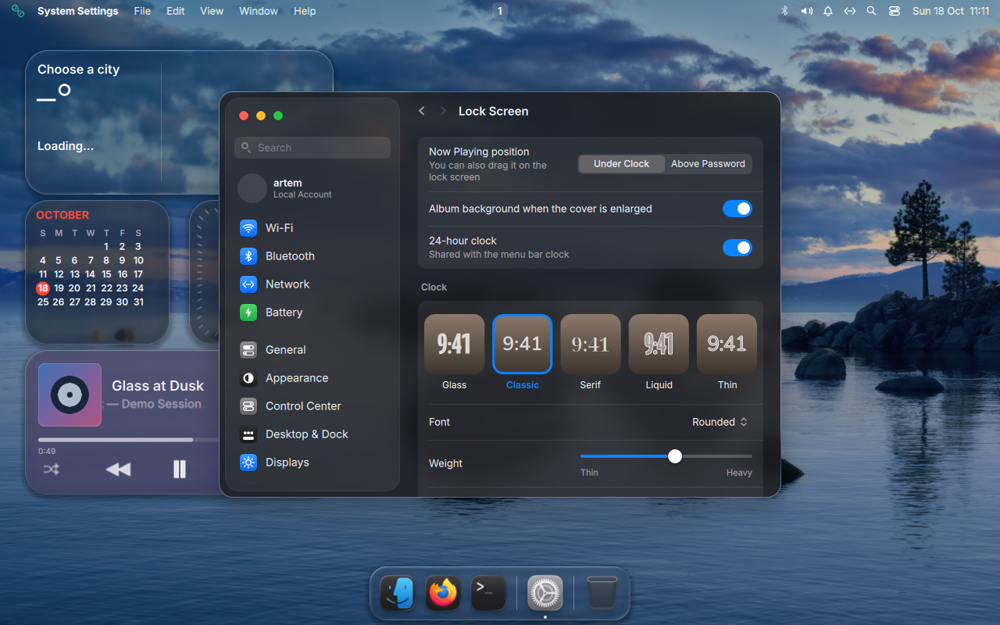
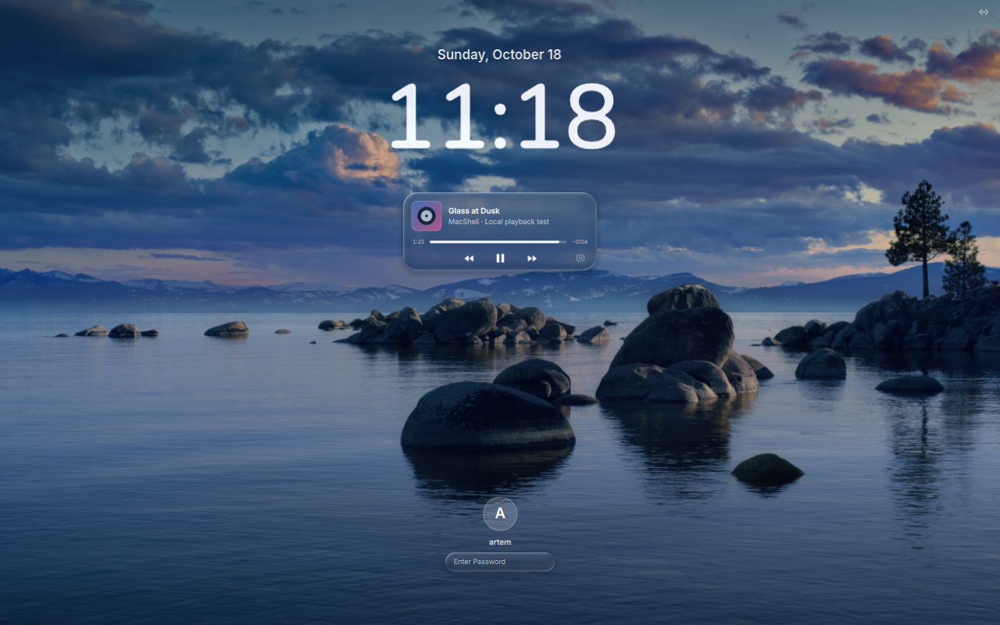
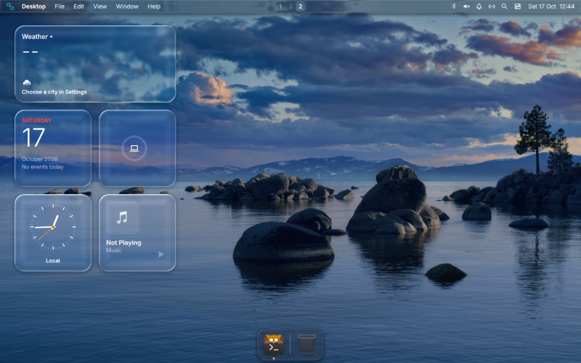
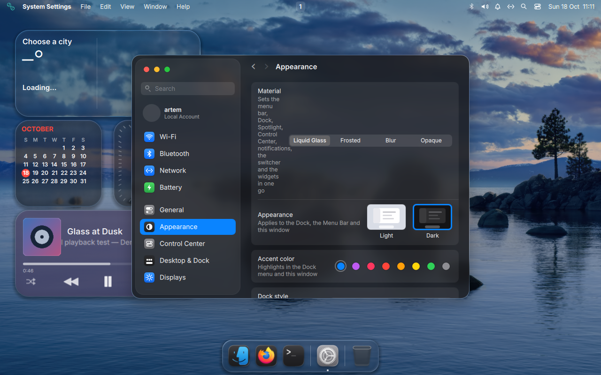

<div align="center">

# MacShell · niri

**A macOS Tahoe-inspired menu bar, Dock, widgets and Liquid Glass — on Linux.**

[](https://github.com/niri-wm/niri)
[](https://get.opensuse.org/tumbleweed/)
[](https://github.com/Artemnuhka/MacShell-niri/actions)

A port of [0-ss/MacShell](https://github.com/0-ss/MacShell), with UI and widgets from [vsoultann/MacShell](https://github.com/vsoultann/MacShell).<br>
A native niri backend, an openSUSE installer and a dedicated session with scene refraction.



[Installation](#installation) · [Gallery](#gallery) · [Shortcuts](#shortcuts) · [Compatibility](#compatibility) · [Credits](#credits-and-licenses)

[🇷🇺 Русская версия](README.ru.md)

</div>

## Gallery

| Control Center | Alt+Tab |
| :---: | :---: |
|  |  |
| Live glass, media controls and quick settings | Window switching through niri IPC |

| Settings | Lock Screen |
| :---: | :---: |
|  |  |
| Frosted surfaces, rounded corners and five clock styles | Visual preview; actual session locking uses PAM |

<details>
<summary>Desktop and appearance</summary>





The screenshots use Tahoe Beach Dusk, selected separately in the test session. Full-resolution Apple wallpapers are not bundled or downloaded by the installer.

</details>

## Features

- **Menu bar and Dock:** application menus, workspaces, system tray, notifications, MPRIS media controls, application icons and a logo matching your distribution.
- **Control Center:** Wi-Fi, Bluetooth, volume, brightness, Focus and customizable controls. Tile entrance animations can be disabled.
- **Liquid Glass:** in the dedicated niri-glass session, lenses refract the scene beneath panels, including application windows. Settings use a denser frosted material.
- **Widgets:** clock, calendar, weather, batteries, music, notes, photos, reminders, stocks and timer/alarms; S/M/L sizes and four materials.
- **Settings:** appearance, menu bar, Dock, widgets, wallpapers and MacLock. Clock fonts are bundled.
- **Spotlight and Alt+Tab:** application and window search, clipboard history, emoji and application switching.
- **MacLock:** a separate PAM-enabled locker with media controls and customizable clocks.
- **Tahoe Dark + Bibata Modern Classic at 20 px** on a fresh installation. A VirtualBox-specific kitty launcher works around virtual GPU artifacts.

This port preserves and adapts the existing MacShell components. See [PORT-PROVENANCE.md](PORT-PROVENANCE.md) for source revisions and attribution.

## Installation

**openSUSE Tumbleweed** is the primary tested distribution. Run the installer as your normal user; it requests `sudo` when system changes are needed.

```sh
git clone https://github.com/Artemnuhka/MacShell-niri.git
cd MacShell-niri
./install.sh --dry-run
./install.sh
```

On openSUSE, the default installation sets up dependencies, the user shell, theme, cursor, configuration and a separate **MacShell Liquid Glass (username)** entry in your login manager. Log out and select that entry after installation. The installer does not start the session itself.

**The first installation may need to build Quickshell and niri-glass.** Builds run at low priority with one job; duration depends on your CPU and connection. Subsequent installations reuse suitable private builds. These live in your user directory and do not replace the system niri binary.

Without a login manager, start from a **text TTY**:

```sh
~/.local/bin/macshell-glass-session
```

Starting another compositor from a terminal inside your current desktop creates a nested session.

<details>
<summary>Installation options and updates</summary>

```sh
./install.sh --no-glass                   # stock niri, without optical refraction
./install.sh --theme keep --cursor keep  # keep your current appearance
./install.sh --theme tahoe-light         # light theme
./install.sh --no-login-session          # TTY launcher only, no login-manager entry
./install.sh --skip-deps                 # dependencies and private compositor are ready
./install.sh --no-extras                 # skip optional utilities
./install.sh --no-clock-fonts            # skip bundled clock fonts
./install.sh --no-config                 # do not edit the niri configuration
./install.sh --keep-xwayland-config      # configure Xwayland manually
./install.sh --niri-config /path/config.kdl
```

To update:

```sh
git pull --ff-only
./install.sh
```

Existing appearance and glass settings are preserved. Legacy widget settings are migrated only if the new file does not exist. After a Qt update, rebuild the private Quickshell if necessary with `./install.sh --build-quickshell`.

For a minimal **openSUSE guest in VirtualBox**, explicitly enable:

```sh
./install.sh --prepare-vm
```

This checks VirtualBox DMI, creates backups, changes official openSUSE HTTP mirrors to HTTPS and, if necessary, replaces `kernel-default-base` with `kernel-default` containing `vmwgfx`. The guest may need a reboot. This preparation is not part of a normal installation.

Third-party repositories are not added by default. You can explicitly enable the openSUSE X11:Wayland repository with `--with-wayland-repo` if needed.

</details>

### Existing systems and NVIDIA

The normal installer **does not run `zypper dup` or configure graphics drivers**. Before installing packages, it checks the XML output of `zypper --dry-run` and stops if the plan includes removals, vendor changes, kernel or KMP changes, or changes to NVIDIA/CUDA/nouveau/bbswitch packages. Existing configurations are backed up, and the proposed niri configuration is checked with `niri validate` before replacement.

These checks guard against those package-plan changes; they do not guarantee compatibility with every existing installation. Physical NVIDIA hardware has not been tested.

### Xwayland without a separate window

The port uses rootless **xwayland-satellite**, managed by niri:

```kdl
xwayland-satellite {
    path "xwayland-satellite"
}
```

Niri creates the socket, sets `DISPLAY` and launches satellite when the first X11 application starts. The installer removes simple legacy Xwayland startup commands and fixed `DISPLAY` values from the configuration it edits. Ambiguous shell commands and includes require manual migration; in that case, the original file is left untouched. External systemd/XDG-autostart services and shell profiles are not disabled by the installer.

### First steps

Open Settings from the Dock. Enter your city in **General → Desktop Widgets → City for weather**: weather uses Open-Meteo, with no automatic IP geolocation. Choose your wallpaper and arrange your widgets. If a keyboard shortcut is already assigned, the installer keeps your binding and reports the conflict.

## Shortcuts

| Shortcut | Action |
| --- | --- |
| `Super + Space` | Spotlight |
| `Super + V` | Clipboard history |
| `Super + .` | Emoji |
| `Alt + Tab` / `Alt + Shift + Tab` | Switch applications |
| Release `Alt` / press `Escape` | Confirm / cancel selection |
| `Super + L` | MacLock |
| `Ctrl + Alt + W` | Wallpaper picker |

You can also use IPC:

```sh
~/.local/bin/macshell-niri ipc call settings open
~/.local/bin/macshell-niri ipc call controlcenter open
~/.local/bin/macshell-niri ipc call clock open
~/.local/bin/macshell-niri ipc call about open
```

## Compatibility

Tested in **VirtualBox on openSUSE Tumbleweed 20261014**, with niri 26.04, xwayland-satellite 0.8.3 and a private Quickshell 0.3.2 build. MacLock requires a separate PAM-enabled Quickshell, which the installer checks independently.

| Environment | Status |
| --- | --- |
| openSUSE Tumbleweed / VirtualBox | Primary test environment: installation, updates and graphical session |
| Physical PC / NVIDIA / multiple monitors | Not tested on hardware |
| Arch / Fedora | pacman/dnf support exists in the installer; a full installation has not been tested |
| Leap / Slowroll | Requires sufficiently recent niri, Qt and satellite packages |
| MicroOS / Aeon / Kalpa | Automatic package installation is disabled; prepare dependencies using the normal transactional-update workflow, then use `--skip-deps` |

**Known limitations:**

- Real refraction requires the pinned private niri-glass session and remains experimental. Stock niri does not provide the same effect.
- Live per-window thumbnails in the Dock/Alt+Tab are not available yet; application icons are used instead.
- A single theme cannot make every GTK/Qt/Electron/X11 application identical to macOS. niri does not provide conventional window minimization into the Dock.
- Wi-Fi, Bluetooth, battery controls, Night Shift and screen recording need separate testing on real hardware. Screen sharing requires a working desktop portal.
- Do not run the original MacShell and this port simultaneously; other panels and notification daemons can also conflict.
- Glass uses GPU resources; choose its material and intensity in Settings. Performance in a small VM is not a reliable estimate for a physical PC.

## Uninstall and rollback

```sh
./install.sh --restore-theme  # restore saved GTK/kitty/niri settings
./install.sh --uninstall     # remove the shell, its bindings and managed login entry
```

Settings, backups, dependencies and private builds are retained. To fully undo Xwayland migration, restore the appropriate niri configuration backup. Widgets are stored in `~/.config/macshell/widgets.json`, clock settings in `~/.config/macshell/clock.json`, and menu bar/Dock settings in `~/.config/macbar` and `~/.config/macdock`.

## Checks

```sh
python3 -m unittest discover -s tests -v
node tests/niri-state.test.cjs
```

CI checks the installer and migrations, niri event reducer, Python/shell syntax and QML parsing. Automated checks do not replace graphical testing. Test GUI applications, temporary recordings, logs and VM access keys are not included in the public tree.

## Credits and licenses

- [0-ss/MacShell](https://github.com/0-ss/MacShell) — original shell, MIT.
- [vsoultann/MacShell](https://github.com/vsoultann/MacShell) — settings UI, widgets and animation improvements, adapted for niri with attribution.
- [niri](https://github.com/niri-wm/niri) and [Niri-glass](https://github.com/zaroutt/Niri-glass) — compositor and glass integration, GPL-3.0. Sources and licenses are retained alongside the private build.
- [MacTahoe GTK](https://github.com/vinceliuice/MacTahoe-gtk-theme) — MIT; [MacTahoe icons](https://github.com/vinceliuice/MacTahoe-icon-theme) and [Bibata](https://github.com/ful1e5/Bibata_Cursor) — GPL-3.0.
- Bundled clock fonts — SIL Open Font License; licenses and pinned SHA-256 hashes are in `vendor/clock-fonts`.

Third-party licenses and pinned versions are in `vendor/`. The root [LICENSE](LICENSE) covers MacShell's MIT code and does not replace third-party licenses. Original documentation: [README.upstream.md](README.upstream.md).
