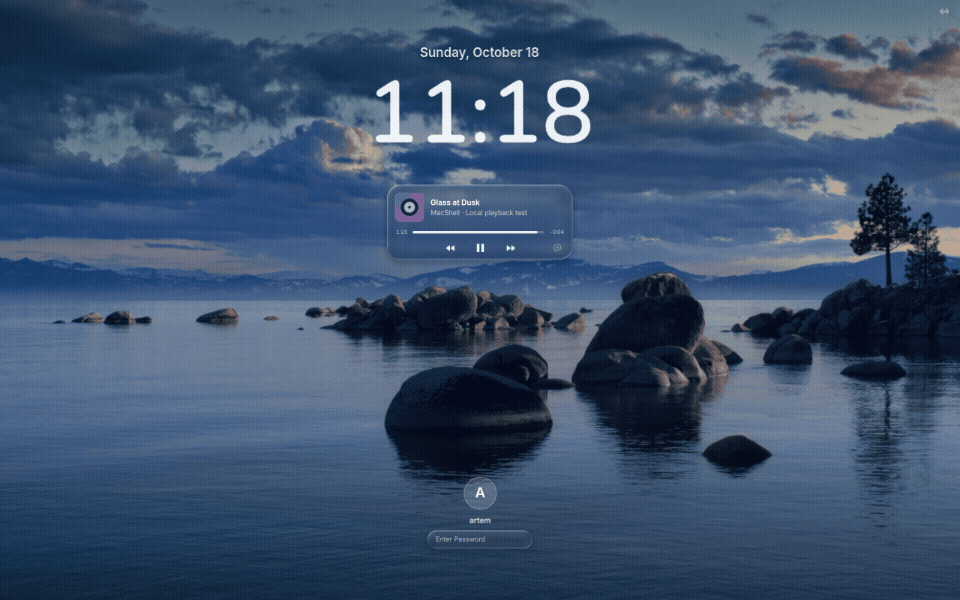
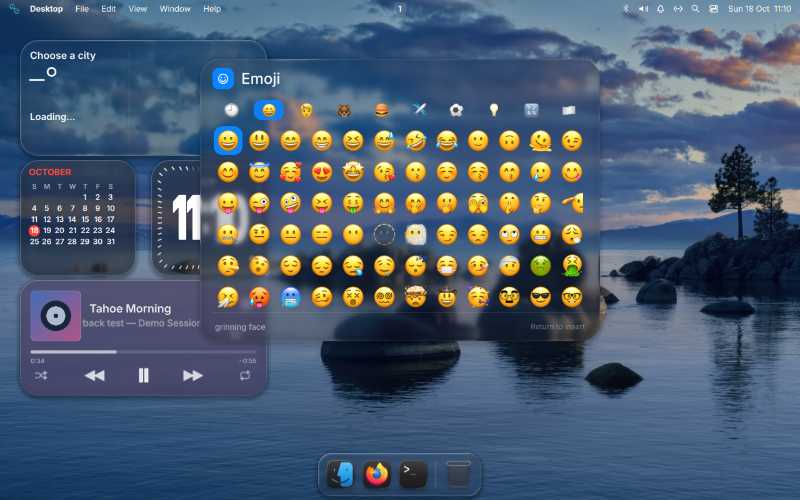
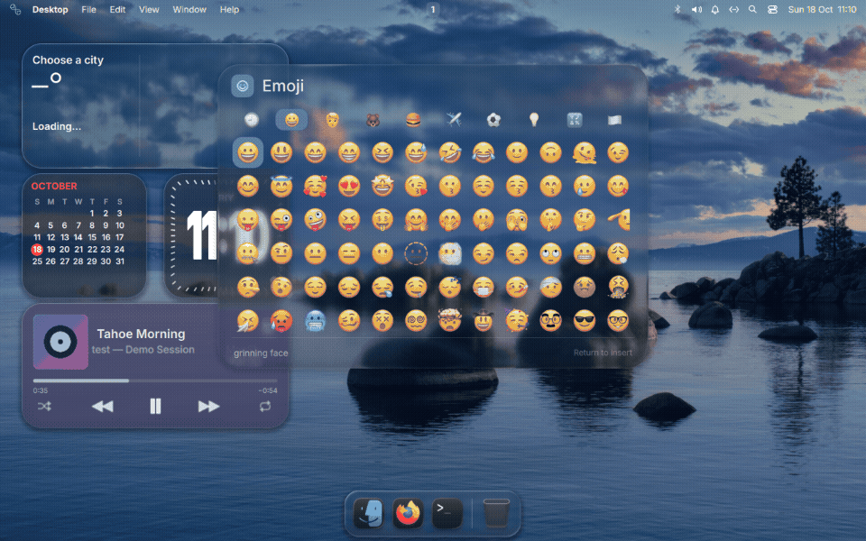
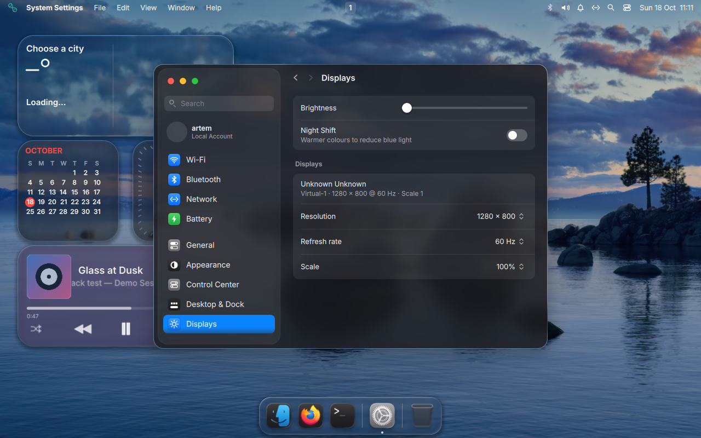

<div align="center">

# MacShell · niri

**Панель, Dock, виджеты и Liquid Glass в духе macOS Tahoe — на Linux.**

[](https://github.com/niri-wm/niri)
[](https://get.opensuse.org/tumbleweed/)
[](https://github.com/Artemnuhka/MacShell-niri/actions)

Порт [0-ss/MacShell](https://github.com/0-ss/MacShell) с интерфейсом и виджетами из [vsoultann/MacShell](https://github.com/vsoultann/MacShell).<br>
Собственный backend niri, установщик для openSUSE и отдельный сеанс с преломлением сцены.


[Установка](#установка) · [Галерея](#галерея) · [Клавиши](#клавиши) · [Совместимость](#совместимость) · [Авторы](#авторы-и-лицензии)

[English](README.md) · **Русский**

</div>

## Галерея

| Control Center | Alt+Tab |
| :---: | :---: |
|  |  |
| Живое стекло, плеер и быстрые настройки | Переключение окон через niri IPC |

| Настройки | Экран блокировки |
| :---: | :---: |
|  |  |
| Матовые поверхности, скругления, пять стилей часов | Предпросмотр внешнего вида; настоящая блокировка использует PAM |

| Spotlight · Apple Emoji | Музыка · MPRIS |
| :---: | :---: |
|  |  |

<details>
<summary>Рабочий стол и оформление</summary>




Обои на снимках — Tahoe Beach Dusk, выбраны отдельно в тестовом сеансе. Полноразмерные обои Apple в репозиторий не включены и установщиком не загружаются.

</details>

## Что внутри

- **Панель и Dock:** меню приложений, рабочие столы, трей, уведомления, MPRIS-плеер, нормальные иконки приложений и логотип текущего дистрибутива.
- **Control Center:** Wi-Fi, Bluetooth, звук, яркость, Focus и настраиваемое расположение элементов. Анимацию появления плиток можно отключить.
- **Liquid Glass:** в отдельном сеансе niri-glass линзы преломляют сцену под панелями, включая окна приложений. Настройки используют более плотное матовое оформление.
- **Виджеты:** часы, календарь, погода, батареи, музыка, заметки, фотографии, напоминания, акции и таймер/будильники; размеры S/M/L и четыре материала.
- **Настройки:** оформление, панель, Dock, виджеты, обои и MacLock. Часовые шрифты включены в комплект.
- **Spotlight и Alt+Tab:** поиск приложений и окон, буфер обмена, эмодзи и переключатель приложений.
- **MacLock:** отдельный locker с PAM, музыкальным плеером и вариантами часов.
- **Tahoe Dark + Bibata Modern Classic 20 px** в отдельном сеансе, без изменения общих настроек оформления. Для kitty в VirtualBox включается отдельный обход артефактов виртуального GPU.

Это перенос существующей оболочки: исходные компоненты MacShell сохранены и адаптированы. Подробности версий и заимствований — в [PORT-PROVENANCE.md](PORT-PROVENANCE.md).

Раскладки и варианты XKB добавляются и удаляются в Settings → Keyboard; там же
выбирается сочетание для переключения. Значок в баре открывает меню источников ввода.
ПКМ по приложению в Spotlight открывает меню запуска и закрепления в Dock, сохраняя Spotlight открытым.

Portal настраивается отдельно для niri: GTK — тема и файловый диалог, WLR — скриншоты,
GNOME — демонстрация экрана. Цветовая схема приложений следует Light/Dark в MacShell;
маршрутизация portal в Plasma сохраняется. При переключении Light/Dark обновляется
GNOME-параметр `color-scheme`; CSS GTK и цвета Plasma не переписываются.
[Настройка portal в niri](https://niri-wm.github.io/niri/Important-Software.html).

## Установка

Основная проверенная система — **openSUSE Tumbleweed**. Запускайте от своего пользователя; `sudo` установщик запросит сам для системных действий.

```sh
git clone https://github.com/Artemnuhka/MacShell-niri.git
cd MacShell-niri
./install.sh --dry-run
./install.sh
```

На openSUSE установщик добавляет зависимости, пользовательские файлы MacShell и отдельный пункт **MacShell Liquid Glass (имя пользователя)** в менеджере входа. Создаёт `~/.config/niri/macshell.kdl` на основе существующего конфига или шаблона и отдельный `macshell-glass.kdl` для преломления. Обычный `niri/config.kdl` остаётся нетронутым. Текущий сеанс установщик не переключает и не останавливает.

### Возврат в KDE Plasma и сохранение конфигов

По умолчанию не меняются настройки Plasma/KWin, общие GTK3/GTK4 CSS и preferences, настройки Qt, kitty и исходный конфиг niri. Темы, иконки и курсор устанавливаются как ресурсы; MacShell выбирает иконки и передаёт GTK-тему своему процессу и запущенным из него приложениям. Автологин SDDM, рабочий стол по умолчанию, видеодрайверы и службы Plasma не перенастраиваются.

**Чтобы вернуться в KDE Plasma, выйдите из MacShell и выберите Plasma на экране входа. Удалять MacShell для этого не нужно.** Отдельный обычный niri запускается через `~/.local/bin/macshell-niri-session`, вариант со стеклом — через `macshell-glass-session`. Запускайте их из TTY или менеджера входа.

Общие настройки оформления меняются только с явным `--global-appearance`, исходный конфиг niri — только с `--integrate-config`. Для обычной установки отдельного сеанса эти флаги не нужны.

**Первая установка может потребовать сборку Quickshell и niri-glass.** Она идёт с низким приоритетом, в одно задание; продолжительность зависит от CPU и сети. При повторной установке подходящие частные сборки используются повторно. Они находятся в пользовательском каталоге и не заменяют системный niri.

Если менеджера входа нет, запускайте из **текстовой TTY**:

```sh
~/.local/bin/macshell-glass-session
```

Не запускайте ещё один compositor из терминала внутри действующего рабочего стола: получится вложенный сеанс.

<details>
<summary>Варианты установки и обновление</summary>

```sh
./install.sh --no-glass                   # штатный niri, без оптического преломления
./install.sh --theme keep --cursor keep --icons keep  # не устанавливать оформление MacShell
./install.sh --theme tahoe-light         # светлая тема
./install.sh --no-login-session          # запуск из TTY, без пункта менеджера входа
./install.sh --skip-deps                 # зависимости и частный compositor уже готовы
./install.sh --no-extras                 # без необязательных утилит
./install.sh --no-clock-fonts            # не устанавливать комплект часовых шрифтов
./install.sh --no-config                 # только оболочка, без частных конфигов compositor
./install.sh --keep-xwayland-config      # настройка Xwayland вручную
./install.sh --niri-config /path/config.kdl  # источник для отдельной копии macshell.kdl
./install.sh --global-appearance         # явно разрешить общие изменения GTK/Qt/kitty
./install.sh --integrate-config          # явно разрешить изменения исходного конфига niri
```

Для обновления:

```sh
git pull --ff-only
./install.sh
```

Существующие настройки оформления и стекла сохраняются. Старые настройки виджетов мигрируются только при отсутствии нового файла. После обновления Qt частный Quickshell при необходимости пересобирается командой `./install.sh --build-quickshell`.

Для облегчённой **openSUSE в VirtualBox** есть явный режим:

```sh
./install.sh --prepare-vm
```

Он проверяет DMI VirtualBox, делает резервные копии, меняет официальные HTTP-зеркала openSUSE на HTTPS и при необходимости заменяет `kernel-default-base` на `kernel-default` с `vmwgfx`. Может потребоваться перезагрузка гостя. На обычной установке этот режим не выполняется.

Сторонние репозитории по умолчанию не добавляются. При необходимости можно явно выбрать `--with-wayland-repo` для openSUSE X11:Wayland.

</details>

### Существующая система и NVIDIA

Обычный установщик **не выполняет `zypper dup` и не настраивает видеодрайверы**. Перед установкой пакетов проверяется XML-план `zypper --dry-run`: при удалениях, смене поставщика, изменениях ядра, KMP-модулей или NVIDIA/CUDA/nouveau/bbswitch работа останавливается. Существующие конфиги сохраняются перед изменением, кандидат конфига niri проверяется через `niri validate`.

Это защита от таких изменений пакетного плана; совместимость с любой давно установленной системой не гарантирована. Физическая NVIDIA в тестировании не участвовала.

### Xwayland без отдельного окна

Используется rootless **xwayland-satellite**, которым управляет niri:

```kdl
xwayland-satellite {
    path "xwayland-satellite"
}
```

Niri создаёт сокет, выставляет `DISPLAY` и запускает satellite при первом X11-приложении. Установщик убирает простые старые автозапуски Xwayland и фиксированный `DISPLAY` из редактируемого конфига. Неоднозначные shell-команды и include требуют ручной миграции: исходник в таком случае не переписывается. Внешние systemd/XDG-autostart-сервисы и профили оболочки установщик не отключает.

### Первые настройки

Откройте Settings из Dock. В **General → Desktop Widgets → City for weather** укажите город: погода использует Open-Meteo, автоматического определения местоположения по IP нет. Выберите свои обои и расположение виджетов. При уже занятом сочетании клавиш установщик сохраняет вашу привязку и сообщает о конфликте.

## Клавиши

| Сочетание | Действие |
| --- | --- |
| `Super + Space` | Spotlight |
| `Super + V` | Буфер обмена |
| `Super + .` | Эмодзи |
| `Alt + Tab` / `Alt + Shift + Tab` | Переключение приложений |
| Отпустить `Alt` / `Escape` | Подтвердить / отменить выбор |
| `Super + L` | MacLock |
| `Ctrl + Alt + W` | Выбор обоев |

Также доступны команды:

```sh
~/.local/bin/macshell-niri ipc call settings open
~/.local/bin/macshell-niri ipc call controlcenter open
~/.local/bin/macshell-niri ipc call clock open
~/.local/bin/macshell-niri ipc call about open
```

## Совместимость

Проверки выполнены в **VirtualBox, openSUSE Tumbleweed 20261014**, niri 26.04, xwayland-satellite 0.8.3 и частном Quickshell 0.3.2. Для MacLock нужен отдельный Quickshell с поддержкой PAM; установщик проверяет его отдельно.

| Среда | Статус |
| --- | --- |
| openSUSE Tumbleweed / VirtualBox | Основная тестовая среда: установка, обновление и графический сеанс |
| Физический ПК / NVIDIA / несколько мониторов | Не проверено на оборудовании |
| Arch / Fedora | В установщике есть pacman/dnf; полная установка не проверена |
| Leap / Slowroll | Требуется доступность достаточно новых niri, Qt и satellite |
| MicroOS / Aeon / Kalpa | Автоустановка пакетов отключена; подготовьте зависимости штатным transactional-update, затем `--skip-deps` |

**Известные ограничения:**

- Сеанс с настоящим преломлением использует закреплённый частный niri-glass и остаётся экспериментальным. Штатный niri не даёт такой же эффект.
- Живых миниатюр отдельных окон в Dock/Alt+Tab пока нет: используются иконки приложений.
- Полная идентичность macOS для всех GTK/Qt/Electron/X11-приложений недостижима одной темой. niri не предоставляет обычное сворачивание окна в Dock.
- Wi-Fi, Bluetooth, батарея, Night Shift и экранная запись требуют отдельной проверки на реальном оборудовании. Для screen sharing нужен работающий desktop portal.
- Не запускайте одновременно оригинальный MacShell и этот порт; другие панели и демоны уведомлений тоже могут конфликтовать.
- Стекло расходует GPU; режим и интенсивность выбираются в настройках. Результаты маленькой VM нельзя переносить на физический ПК как оценку производительности.

## Удаление и откат

```sh
./install.sh --restore-theme  # вернуть сохранённые настройки GTK/kitty/niri
./install.sh --uninstall     # убрать оболочку, её привязки и управляемый пункт входа
```

Настройки, резервные копии, зависимости, шрифты/темы и частные сборки остаются. Неизменённые файлы сеанса удаляются по манифесту с контрольными суммами; изменённые пользователем сохраняются. Изменённая оболочка переносится в backup. Одинаковая повторная установка не создаёт лишние backup запускателей и оболочки. По умолчанию миграция Xwayland затрагивает только частные конфиги; если использовался `--integrate-config`, для полного отката восстановите его backup. Виджеты хранятся в `~/.config/macshell/widgets.json`, настройки часов — `~/.config/macshell/clock.json`, панели и Dock — в `~/.config/macbar` и `~/.config/macdock`.

## Проверки

```sh
python3 -m unittest discover -s tests -v
node tests/niri-state.test.cjs
node tests/display-state.test.cjs
```

CI проверяет миграции и установщик, редуктор niri, синтаксис Python/shell и QML-парсер. Автоматические проверки не заменяют графическую сессию. В публичное дерево не включены тестовые GUI-приложения, временные записи, логи и ключи доступа к VM.

## Авторы и лицензии

- [0-ss/MacShell](https://github.com/0-ss/MacShell) — исходная оболочка, MIT.
- [vsoultann/MacShell](https://github.com/vsoultann/MacShell) — развитие интерфейса настроек, виджетов и анимаций; изменения адаптированы для niri с указанием происхождения.
- [niri](https://github.com/niri-wm/niri) и [Niri-glass](https://github.com/zaroutt/Niri-glass) — compositor и интеграция стекла, GPL-3.0. Исходники и лицензии сохраняются рядом с частной сборкой.
- [MacTahoe GTK](https://github.com/vinceliuice/MacTahoe-gtk-theme) — MIT; [MacTahoe icons](https://github.com/vinceliuice/MacTahoe-icon-theme) и [Bibata](https://github.com/ful1e5/Bibata_Cursor) — GPL-3.0.
- Комплект часовых шрифтов — SIL Open Font License; лицензии и закреплённые SHA-256 в `vendor/clock-fonts`.

Лицензии и закреплённые версии сторонних ресурсов находятся в `vendor/`. Корневой [LICENSE](LICENSE) относится к MIT-коду MacShell, а не заменяет лицензии сторонних частей. Исходный README: [README.upstream.md](README.upstream.md).

## Обновление upstream от 18 октября

Перенесён 0-ss/MacShell `831548c`: исходный шейдер и оригинальные часы/календарь/погода/плеер,
прозрачная верхняя полоса, Dock без зерна с радиусом 22px по скриншоту. Дополнительные виджеты
Tahoe сохранены. Image позволяет выбрать свой файл и сохраняет его копию. Widget size меняет
масштаб виджетов и сетки от 60% до 150%. Bluetooth теперь поддерживает поиск, сопряжение,
подключение и отображение ошибок через общий backend панели и настроек.

Выпадающие меню преломляют снимок рабочего стола перед открытием, включая окна. Пока меню
открыто, этот снимок неподвижен. В частном сеансе niri-glass непрерывное преломление за Dock и Spotlight включено
по умолчанию; этот режим остаётся экспериментальным. Миниатюры отдельных окон
по-прежнему недоступны.

`macshell-niri-update check|log|update|rollback|status` работает только с niri-форком.
`macshell-niri-update channel main` / `release` выбирает канал. Launcher не допускает дубликатов
оболочки в одном сеансе и перезапускает её после падения. Обновления сохраняют настройки,
а резервная копия и откат включают MacLock. Автоматический таймер не включается.

Super + 1…9 переключает рабочие столы по позиции. Верхняя панель показывает только
активные или занятые столы; девять пустых столов не создаются. В комплекте MacOS-Like —
тема иконок, рекомендованная оригинальным репозиторием. По умолчанию тёмная;
`--icons macos-like-light` выбирает светлую, `--icons keep` сохраняет текущую.
Шрифт текста — Inter; SF Pro не включён.

## Несколько мониторов, NVIDIA и эмодзи

Док можно показывать на всех экранах, основном или текущем. При отключении выбранного
монитора он переходит на доступный. Виджеты сохраняют исходный экран и координаты:
при отключении становятся доступны на другом экране, а при подключении возвращаются.
В режиме редактирования есть кнопка **Next display**. В настройках дисплеев доступны
разрешение, частота, дробный масштаб и расположение относительно другого экрана;
неподтверждённое изменение откатывается через 15 секунд. Сохранённые параметры
восстанавливаются при подключении. Координаты учитывают масштаб, вертикальные экраны
и отрицательное расположение в общей области рабочего стола.

Для NVIDIA установщик создаёт отдельный пользовательский профиль управления видеопамятью
для `niri` и `niri-glass` по рекомендации niri. Launcher частного сеанса проверяет его до
запуска композитора. Драйвер, PRIME, параметры загрузки и чужие профили не меняются.
`macshell-niri-doctor` показывает GPU, драйвер, DRM modesetting и переменные рендеринга.
Нужен современный NVIDIA-драйвер с GBM и включённым DRM modesetting. Инструкция:
https://niri-wm.github.io/niri/Nvidia.html.
На физической NVIDIA и нескольких реальных мониторах пока не проверено. Автотесты
проверяют три экрана, разный масштаб и переподключение; GUI проверен в VirtualBox.

Spotlight предпочитает **Apple Color Emoji**, если шрифт установлен. Команда
`macshell-niri-emoji install-apple` отдельно загружает закреплённую Linux-сборку из
https://github.com/samuelngs/apple-emoji-ttf и проверяет SHA-256. Сам шрифт не включён
в репозиторий. После установки перезапусти MacShell. Системные подстановки шрифтов
не меняются; другие цветные эмодзи остаются запасным вариантом. Шрифт текста — Inter.

Настройки и Alt+Tab также получают снимок сцены с окнами перед открытием. У каждого Qt-окна своя текстура; пока интерфейс открыт, фон неподвижен.
